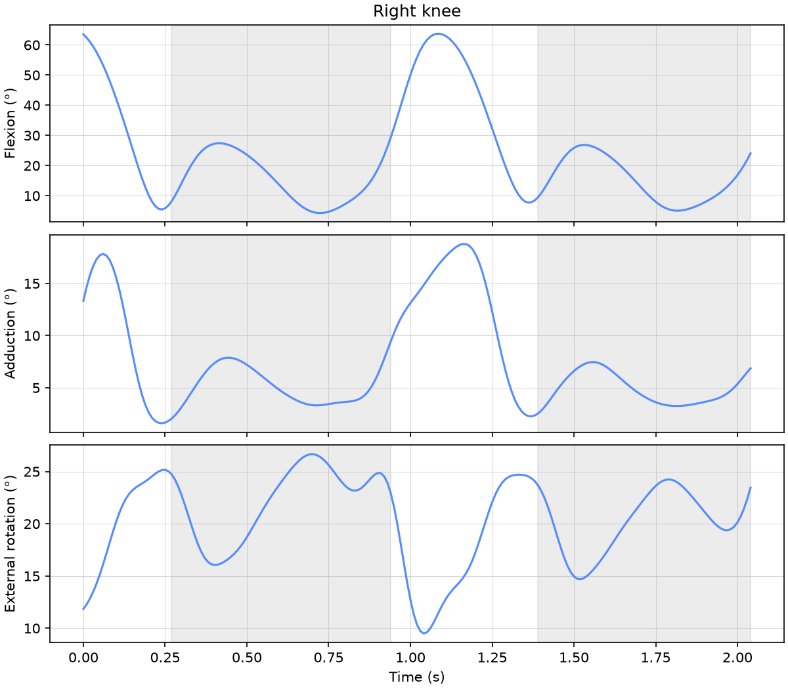

# MoCap-JointKinematics

A short review of segment coordinate systems and 3D joint angles in
marker-based motion capture, with examples on real data and a focus on
Cardan angles and the Joint Coordinate System.

## Overview

This repository provides a walkthrough of how joint angles are calculated, from
three rotations to the Joint Coordinate System of Grood and Suntay. The method
is checked step by step, then applied to the right knee and ankle of a walking
trial. The notebook ends with the clinical meaning of the angles and the limits
of the small ones.



## What's Included

- **Example Data**: A sample C3D file (`data/dynamic.c3d`) with marker
  trajectories of a walking trial, from the
  [openOFM](https://github.com/mcgillmotionlab/openOFM) repository (GPL-3.0)
- **Core Functions**: Short Python functions (`utils/joint_functions.py`) that
  load the data, build the segment axes, calculate the angles and plot
- **Sample Workflow**: Jupyter notebook with a literature review on joint
  angles, and working examples
- **Visualizations**: Plots of gimbal lock and of the knee and ankle angles

## Background

### Joint Angles in 3D

In 3D, a joint angle needs three rotations, and their values depend on the
axes of each segment, the order of the rotations and the signs. The same
orientation can therefore give different numbers.

### Topics Covered

The notebook covers five topics:
- Joint angle basics (three rotations, and why their order matters)
- Euler and Cardan angles (sequences and gimbal lock)
- The Joint Coordinate System of Grood and Suntay
- Knee and ankle angles during walking
- Clinical interpretation of joint angles

## Getting Started

### Quick Start

Open the Jupyter notebook to view the example workflow (GitHub shows it with
all plots and results saved). The notebook only calls the functions in
`utils/joint_functions.py`.

To run it yourself, create the conda environment (it installs Python 3.12 and
all packages) and start Jupyter:

```bash
conda env create -f environment.yml
conda activate edkp616-joint-kinematics
jupyter lab
```

Then open `EDKP616_Joint_Kinematics.ipynb` and run all cells. Keep the `data`,
`utils` and `figures` folders next to the notebook.

Without conda, you need **Python 3.10 or newer** (the `ezc3d` package does not
install on Python 3.9) and a virtual environment:

```bash
python -m venv .venv
source .venv/bin/activate          # Windows: .venv\Scripts\activate
pip install -r requirements.txt
jupyter lab
```

## References

Cole, G. K., Nigg, B. M., Ronsky, J. L., & Yeadon, M. R. (1993). Application of
the joint coordinate system to three-dimensional joint attitude and movement
representation: A standardization proposal. Journal of Biomechanical
Engineering, 115(4A), 344–349. https://doi.org/10.1115/1.2895496

Grood, E. S., & Suntay, W. J. (1983). A joint coordinate system for the clinical
description of three-dimensional motions: Application to the knee. Journal of
Biomechanical Engineering, 105(2), 136–144. https://doi.org/10.1115/1.3138397

Wu, G., Siegler, S., Allard, P., Kirtley, C., Leardini, A., Rosenbaum, D., ...
Stokes, I. (2002). ISB recommendation on definitions of joint coordinate system
of various joints for the reporting of human joint motion—Part I: Ankle, hip,
and spine. Journal of Biomechanics, 35(4), 543–548.
https://doi.org/10.1016/S0021-9290(01)00222-6

The full reference list is at the end of the notebook.

## Contributing

This is an educational resource. If you find errors, have suggestions for
improvements, or want to add additional examples, please open an issue or
submit a pull request.

## License

This project is released under the [GNU General Public License v3.0](LICENSE).
The sample data file (`data/dynamic.c3d`) comes from
[openOFM](https://github.com/mcgillmotionlab/openOFM), which is also released
under GPL-3.0.
